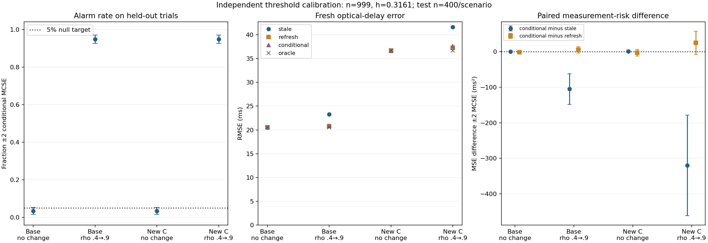

# Can a calibrated alarm survive a change in clock-error covariance?

A **45–60 minute optics, camera, vision and mathematics learning lab**. Calibrate a pilot alarm on independent synthetic no-change sequences, then test covariance transfer and fresh optical-delay error. The previous lesson used a fixed .25 threshold; this lesson derives a rank-calibrated threshold and an analytic invariance control.

## Objectives and run

Learn to derive a finite-simulation alarm rule, distinguish marginal from conditional false-alarm control, prove affine invariance of profile REML, and measure how alarm decisions affect subpixel optical timing. Prerequisites: Gaussian covariance, least squares, elementary Fourier optics and Python. All data are synthetic; no downloads of images or model weights.

```sh
git clone https://github.com/ahmetalpkilic/threshold-transfer-optical-calibration-learning-lab.git
cd threshold-transfer-optical-calibration-learning-lab
sh run_demo.sh
```

Python 3.9–3.12 and POSIX shell. This one command creates `.venv`, installs pinned NumPy/SciPy/Matplotlib, runs tests and writes `outputs/results.json` and `outputs/experiment.png`. Allow several minutes. Installation needs internet; later `.venv/bin/python lab.py` runs offline. `examples/` holds the reference output. Exact last digits can depend on platform. Session: 10 minutes physical model, 15 minutes rank/invariance derivation, 15 minutes code/output inspection, 10–20 minutes exercises.

| Area | Explicit model | Connection |
|---|---|---|
| Optics | 550 nm Gaussian pupil and scalar Fourier image formation | Determines the spot PSF |
| Camera | 16 mm focal length, 4 µm integrated pixels, read noise and clock observations | Samples the image and tags exposure time |
| Vision / metrology | Subpixel spot fit plus affine clock calibration | Infers exposure delay from a known moving point |
| Mathematics | REML, order statistics, affine invariance and paired Monte Carlo risk | Calibrates alarms and tests the measurement consequences |

## Physical model and assumptions

The untruncated pupil amplitude is `exp(-(x²+y²)/a²)`, with radius parameter `a=1000 µm`; this is not a hard circular aperture. Fourier intensity is Gaussian:

```text
sigma_px = lambda*f/(2*pi*a*p) = 0.350140875 px
mu_j(u) = B + F[Phi((j+.5-u)/sigma)-Phi((j-.5-u)/sigma)]
```

Here `lambda=.550 µm`, `f=16000 µm`, `p=4 µm`, `F=10000 ADU`, `B=20 ADU`. Pixel centers j=-16,…,16 increase rightward and integrate [j−.5,j+.5]. The 33 samples are the horizontal marginal of a separable 2-D PSF. Independent Gaussian read noise has SD 2 ADU per marginal sample. Intrinsics are `K=diag(4000,4000,1)` pixels, principal point (0,0), square pixels, no skew/distortion. Scalar paraxial optics, instantaneous exposure and known flux/background/width are assumed. No photon noise, saturation or quantization.

Least squares estimates center u. An independently known trajectory is `u(r)=.23+.8*r` px, with r in reference seconds. Clocks obey `r=alpha*t+beta`, where alpha=1.002 reference s/master s and beta=.030 reference s. The frame timestamp is T=2 master s, true exposure delay delta=.040 master s:

```text
delta_hat = [ (u_hat-.23)/.8 - beta_hat ] / alpha_hat - T
```

Forty synchronization events have latent master times uniformly spanning [−1,1] s. Alternating known classes have timestamp-pair SDs (.030,.020) s and (.120,.040) s, with within-pair correlations .5 and .3. These define marginal C_g in s². Within a repeated constant event, `Cov(e_k,e_l)=rho_g^|k-l| C_g`; blocks reset independently. Repeat index has no physical time interval. Old temporal rho=(0,.4); current rho=(0,.4) or (0,.9).

`MODEL.md` derives the Fourier PSF, exact pixel integration, restricted likelihood and profiled errors-in-variables clock fit. `optics.py`, `characterization.py`, `repeat_model.py` and `clock_model.py` contain annotated core implementations.

## New derivation 1: calibrate without looking at final errors

Fit both old class correlations from 80 pairs/class and pilot correlations from 40 pairs/class. For each independently generated old+pilot pair define

```text
S = max_g |rho_hat_pilot,g - rho_hat_old,g|.
```

This is a two-class family alarm. Simulate n=999 independent no-change pairs at rho=(0,.4), sort their scores and choose

```text
k = ceil((n+1)*(1-alpha)) = 950, alpha=.05
h = S_(k)
Alarm = 1{S_new > h}.
```

Do not use an interpolated percentile. For n+1 exchangeable continuous scores, the new score's rank is uniform. Exactly n+1−k ranks exceed the kth calibration score, hence

```text
P(alarm) = (n+1-k)/(n+1) = .05.
```

Strict exceedance with ties makes this an upper bound. Bounded rho fits can create ties. This is **marginal over training draws and a new old+pilot pair**. It is not a 5% guarantee conditional on a particular saved threshold, fixed old estimate, or repeated sequential inspection. The true no-change rho is known in the training simulator; misspecifying it breaks exchangeability. General order-statistic background is in the [SciPy documentation](https://docs.scipy.org/doc/scipy/reference/generated/scipy.stats.order_statistic.html); this lab implements the rank rule directly and does not require that newer SciPy API.

A distinct seed-tree child generates held-out observations. Training uses no images, evaluation timestamps, policy errors, or alternative-scenario results. Training simulations are offline and cost no physical acquisitions. Every held-out trial independently redraws old characterization; the experiment is not a conditional repeated-pilot guarantee for one instrument.

## New derivation 2: nuisance covariance is an invariance control

For n×2 observations Z and mean-removing precision Q(rho), profile REML minimizes

```text
J_Z(rho) = 2 log|R| + 2 log(1^T R^-1 1)
           + (n-1) log|Z^T Q Z/(n-1)|.
```

Under `Z' = Z A^T + 1 b^T`, where A is nonsingular and b constant, `Q1=0`, so

```text
Z'^T Q Z' = A (Z^T Q Z) A^T
J_Z'(rho) - J_Z(rho) = 2(n-1) log|det A|.
```

The difference is constant in rho: the optimum and alarm statistic are unchanged. Old and pilot sequences may each have different nonsingular transforms. Under separable Gaussian AR(1), all positive-definite column covariances are related this way. Thus changed C alone should not disrupt the null score distribution. This is a stringent analytic control, not evidence of robustness to nonseparability, heavy tails or time-varying covariance.

We change current covariance to `C'_g=A C_g A^T`, with

```text
A = [[1.5, .4], [-.2, .8]].
```

A transforms centered clock errors only; physical means and clock mapping stay fixed. Pilot, refresh, repeat calibration and final timestamp covariance all change; old data retain C. Both variances and within-pair correlation change. JSON records both matrices in s². Common standard-normal draws pair the base/new-C scenarios; the implied Cholesky transforms still satisfy the identity above. The maximum paired score discrepancy is reported, not silently rounded to zero.

## From alarms to measurement risk

On alarm, acquire a separate independent 40-pair/class refresh and use its rho estimates. Otherwise retain the old rho. **Pilot estimates never become whitening estimates.** Every policy includes the common 160 old pairs:

| Policy | Pilot | Refresh | Repeats × 40 events | Total pairs |
|---|---:|---:|---:|---:|
| stale | 0 | 0 | 12×40 | 640 |
| refresh | 0 | 80 | 10×40 | 640 |
| conditional, no alarm / pilot_never | 80 | 0 | 10×40 | 640 |
| conditional, alarm / pilot_always | 80 | 80 | 8×40 | 640 |

The exact-C oracle is a free-information diagnostic, not a feasible budget competitor. Common evaluation uses 40 fresh independent timestamp pairs and a fresh spot image, excluded from each budget. Pair cost is uniform; resets and settling are free. Unused simulated refresh observations exist only to couple controls and are inaccessible to the no-alarm branch.

Whiten repeats with the selected rho and estimate class covariance with `Z^T Q_hat Z/(m-1)`. Under mismatch its conditional expectation is `tr(Q_hat R_current)/(m-1)*C`. Fit alpha,beta to fresh timestamps using the estimated class covariances, then convert the independent fitted spot center into delay. Accurate localization alone cannot repair clock calibration errors:

```text
d(delta) ≈ du/(v*alpha) - d(beta)/alpha - (T+delta)*d(alpha)/alpha.
```

If A_alarm is the decision and e_N/e_R are the two branch errors, then
`Risk = E[(1-A_alarm)e_N²] + E[A_alarm e_R²]`.
Selection depends on the old estimate also used in the no-alarm branch. Do not replace conditional branch risks by unconditional risks. Measure actual end-to-end paired errors.

Annotated new code (`lab.py`):

```python
train_seed, test_seed = np.random.SeedSequence(seed).spawn(2)
scores = null_scores(999, train_seed)  # fresh old+pilot pairs; no final errors
h, k = rank_threshold(scores)         # exact kth order statistic
# policy.experiment receives only h; it cannot retune from measurement risk
base = policy.experiment(..., threshold=h, levels=(.4, .9))
shift = policy.experiment(..., threshold=h, levels=(.4, .9),
                          current_cov=nuisance_covariance())
```

## Validation and expected output

The four scenarios form a controlled 2×2 experiment: unchanged/changed temporal rho and base/transformed covariance. Each uses 400 held-out trials with the same fixed trained threshold. JSON includes training scores, test scores, false alarms/misses, rho boundary fractions, optical center SD, method RMSE/bias/SD, and paired squared-error differences. Solver failures raise; they are not dropped.

Alarm bars are ±2 binomial Monte Carlo standard errors **conditional on this trained threshold**, not a full uncertainty interval including training variation. Paired MSE bars are ±2 SD(error² differences)/sqrt(400), likewise conditional on training. They are not instrument uncertainty or confidence-interval coverage. Near-zero/one rates have poor normal approximations. Scenarios are paired, not independent replicates.

Tests cover Fourier propagation, pixel integration and derivatives, noiseless and independent latent-time clock fitting, REML contrast equivalence, AR simulation, budgets, branch isolation, forced-branch equality, rank combinatorics/ties, affine objective identity, covariance validity, train/test isolation and fresh-seed determinism. The integer-zero REML input bug inherited from the predecessor is fixed with a floating precision diagonal.

The reference run passed **26 tests**. Threshold **h=0.316106**, rank 950/999. Maximum paired score discrepancy across covariance settings: **6.41e-08**. All paired alarm decisions match.

| Covariance | Current odd rho | Alarm rate | Stale RMSE (ms) | Refresh RMSE (ms) | Conditional RMSE (ms) |
|---|---:|---:|---:|---:|---:|
| base | 0.4 | 3.50% | 20.513 | 20.553 | 20.529 |
| base | 0.9 | 94.75% | 23.295 | 20.794 | 20.928 |
| changed covariance | 0.4 | 3.50% | 36.657 | 36.712 | 36.674 |
| changed covariance | 0.9 | 94.75% | 41.680 | 37.314 | 37.647 |

No-change alarms: 14/400 (3.5%); large-change misses: 21/400 (5.25%), identical across covariance settings. A single frozen threshold need not attain exactly 5%. The agreement is a positive control within the assumed model; it is not a guarantee under model mismatch.

At rho=.9 with base, conditional-minus-stale MSE is **-104.67 ± 43.15 ms²** (two MCSE), and conditional-minus-refresh is **5.61 ± 9.01 ms²**.

At rho=.9 with changed covariance, conditional-minus-stale MSE is **-319.92 ± 141.75 ms²** (two MCSE), and conditional-minus-refresh is **24.99 ± 33.10 ms²**.

Optical center SD is 0.0002682 px versus PSF SD 0.3501409 px. Localization repeatability is not optical resolution. At rho=.9, odd-class pilot boundary fits occur in 29.50% of trials. All numerical fits succeeded. The plot was visually inspected. These 400-trial risk comparisons do not prove policy optimality.



## Exercises

1. Prove the uniform-rank bound including the conservative effect of ties. Why is 950 the correct rank for 999 scores at 5%?
2. Derive the additive REML objective shift. Change A while retaining nonsingularity; predict score invariance before running.
3. Freeze one old characterization and draw many pilots. Compare conditional false-alarm rates across several fixed old datasets. Explain why the marginal bound does not promise 5% for each.
4. Change the training seed but keep the evaluation seed fixed in a fork. Quantify training-threshold variability separately from held-out Monte Carlo error; do not choose the best threshold on final errors.
5. Double wavelength consistently in image generation and fitting. Derive the new PSF width, then compare localization and clock contributions to delay error. Keep the alarm training experiment unchanged.

## Limits and next lesson

Known no-change rho, stationary separable Gaussian AR(1), externally scheduled inspection, known classes, affine clocks, known optics/photometry/motion and instantaneous exposure are strong assumptions. The finite rho search interval is [-.95,.95]; reported boundary rates matter. No sequential false-alarm guarantee, optimal policy, universal distribution-free guarantee, or calibrated instrument accuracy is claimed. **Synthetic numerical recovery and repeatability do not establish hardware accuracy or traceability.**

Next: deliberately break separability with two temporal modes in the two-clock errors. Test whether the rank-calibrated alarm transfers under this model mismatch, using affine-covariance invariance as a passing control. Keep tuning separate from final optical-delay risk.

## Attribution and current-source review

New threshold calibration, nuisance-transfer experiment, rank/invariance tests and tutorial are MIT, copyright 2026 ahmetalpkilic. `policy.py` is adapted from [pilot-triggered-optical-calibration-learning-lab at e7bf1091](https://github.com/ahmetalpkilic/pilot-triggered-optical-calibration-learning-lab/tree/e7bf1091a5a95f096664990c624093794c9da21d): added level/covariance inputs and per-trial score output. Its default fixed-threshold experiment is retained for regression tests; `lab.py` is this lesson's entry point. Physical/clock helpers, MODEL and 21 tests originate there and in its attributed predecessors. Notices are preserved in `licenses/`.

Reviewed current public, unarchived prysm (MIT), NumPy and SciPy (BSD-3-Clause), Matplotlib (its permissive license), and predecessor commits. `sources.json` records retrieval time, exact commits, activity, commit subjects and license snapshots. Reviewed prysm Fourier propagation and SciPy order-statistic source; no upstream development code is copied or executed. Runtime dependencies are pinned releases, not reviewed development heads. NumPy/SciPy provide computation; Matplotlib supplies the standalone scientific figure. No modifications to these third-party packages are distributed. Source activity is provenance, not validation of this experiment.
